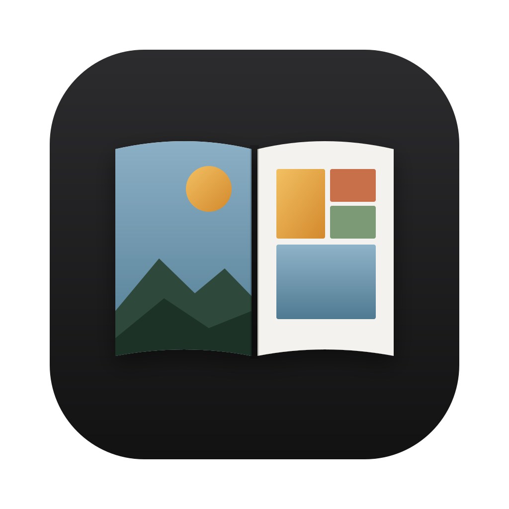
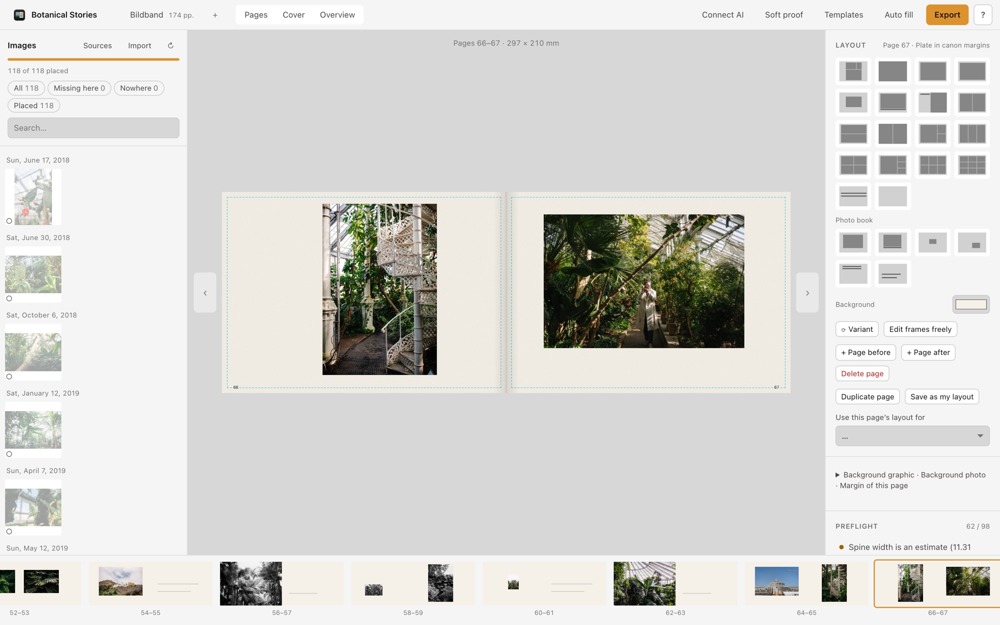
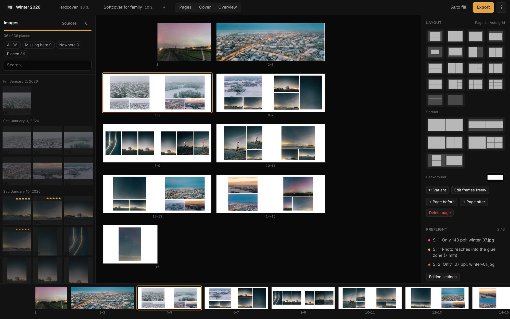
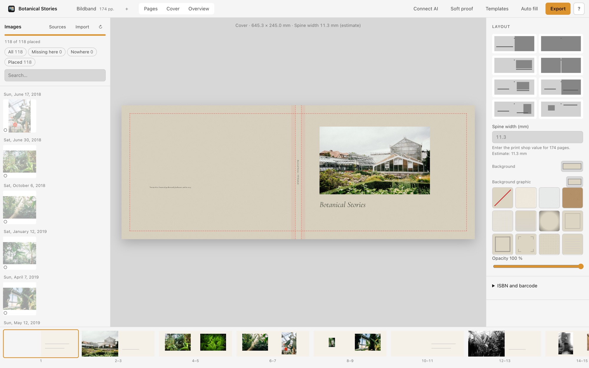
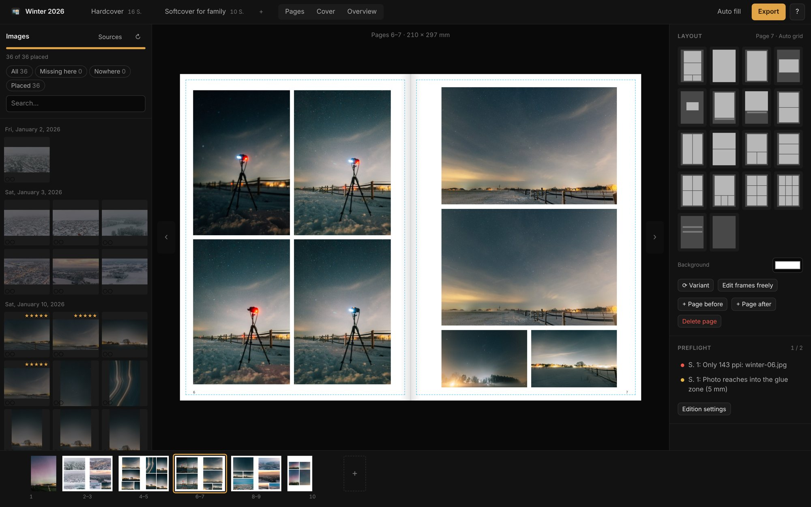
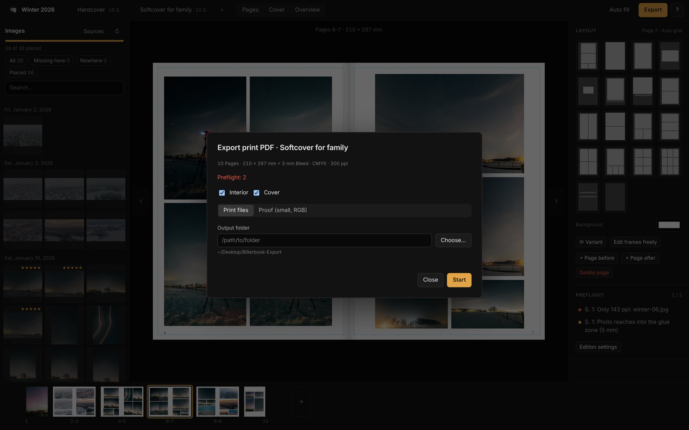

<p align="center"></p>

<h1 align="center">Billerbook</h1>

<p align="center"><b>Lay out photo books fast. Print them anywhere.</b><br>
Open source · macOS app · works with Lightroom Classic, Capture One or any folder · print-ready PDF for every print shop · MCP server for AI assistants</p>

<p align="center">
  <a href="https://github.com/tillheidrich/billerbook/releases/latest">Download for Mac</a> ·
  <a href="https://billerbook.heidrich-digital.de">Website</a> ·
  <a href="docs/mcp.md">AI / MCP</a> ·
  <a href="#deutsch">Deutsch</a>
</p>



*Billerbook* is Low German for picture book. It is the tool I wanted after years of the same routine: pick photos in Lightroom, lay them out in Lightroom's Book module, export a PDF that never quite matched the printer, fix it in InDesign, and fight every crop by hand. Billerbook does the whole thing in one place and writes the PDF the print shop asks for.

## What it does

**One photo pool, several books.** Make the big hardcover for yourself and a shorter portrait softcover for the family from the same photos. Every thumbnail shows which edition already uses it, and the *Missing here* filter lists what is still left out, so the year in photos is actually complete.

**Templates that look like a real photo book.** Seven book templates set fonts, text styles, page colour, cover and the order of the pages in one step: *Monograph* (one photo per right page, the left page white), *Year book* (a chapter page per month), *Gallery*, *Botanical*, *Travel journal*, *Wedding* and a *Christmas year review* with an opening page for a personal line. The preview uses your own photos before you apply anything.

**Layouts that adapt.** 32 page and spread layouts, all calculated from the page size. Copy a landscape hardcover into a portrait softcover and the pages re-flow instead of breaking. The auto grid keeps every photo's aspect ratio, so 3:2 photos are not squeezed into square templates.

**Cropping without the fiddling.** Drag inside a photo to move the crop, scroll to zoom. `F` switches between *fill the frame* and *show the whole photo*. `V` turns a photo into a full-bleed page. `Space` tries the next arrangement for the same photos. Smart crop finds the subject (saliency detection) and centres it before you touch anything.

**Photo-book layouts.** Plates set in the Van de Graaf canon (inner and top margin one ninth of the page, outer and bottom two ninths), a small photo in a lot of white as a pause, a diptych across the gutter, a full-bleed left page next to a white right page, chapter openers. They follow the conventions of printed photo books, not of photo-lab templates.

**Free frames when you need them.** Turn any layout into free frames. Drag the ✥ handle to move a frame, drag the corner to resize, or type position and size in millimetres. Frames snap to margins, centre, thirds, the gutter and the canon block.

**Typography that prints as it looks.** Nine open-licence typefaces are built in (EB Garamond, Source Serif 4, Cormorant Garamond, Playfair Display, DM Serif Display, Work Sans, Jost, Archivo, Caveat), and you can add your own TTF or OTF. Text styles per edition hold font, weight, italic, size, leading, tracking, capitals and colour; change a style and every text using it follows. Text goes into the PDF as outlines, so the print shop needs no fonts, and the editor shows the exact line breaks the PDF will have. Preflight warns when text does not fit its frame or is smaller than 6 pt.

**Tones and graphics.** Black and white, warm, sepia, selenium or cool per photo, without touching the original. Eleven background graphics (paper, kraft, linen, gradient, vignette, frames, corner marks, dot grid, ruled lines), drawn as vector graphics with lines no thinner than 0.3 mm.

**Lightroom Classic, both ways.** Billerbook reads the catalog (also while Lightroom is open), uses your collections as the photo pool, shows Lightroom's previews and picks up captions. Books made in Lightroom's Book module can be imported with their pages, photo positions and crops. Billerbook itself never writes to the catalog. The optional Lightroom plug-in does, and only one thing: it keeps a collection per edition under *Billerbook* in the Collections panel, plus a *missing* collection with the photos that are not in the book yet. So you see in Lightroom which photos are in the book.

**Everything the Book module does, and more.** Duplicate pages (`⌘D`), copy a page layout and paste it on other pages (`⇧⌘C`, `⇧⌘V`) or on every page with the same number of photos, save your own layouts, a background photo with opacity per page, page margin and photo gap per page, page numbers with per-page hiding.

**No Lightroom needed.** Any folder of JPEG, TIFF, PNG or WebP works. Capture date, star rating and caption come from EXIF/XMP/IPTC.

**Capture One, Affinity, InDesign.** Capture One albums, projects and groups can be the photo source (Mac, Capture One running); processed files from an export folder are matched by name. Any book exports as IDML, which Affinity (free) and InDesign open as an editable layout with image and text frames, for the last touches in a full layout program.

**See the whole book.** The overview tab shows every spread at once, the page overview PDF puts them on A4 sheets for sign-off, and assistants get the same view through `view_overview`.

**Print-ready PDF for the printer you choose.** Interior as single pages or as spreads (one PDF page per double page, as Saal Digital wants), cover as one sheet with back, spine and front. Bleed, TrimBox/BleedBox, CMYK with an ICC output intent (e.g. FOGRA39) or sRGB, resampling to the target resolution and output sharpening. The spine width follows from page count and paper: from the printer's published formula (KDP, Lulu), its table (Lulu hardcover), the cover template you download from the printer, or the value you enter. The PDF is written page by page, so a 500-page book does not need gigabytes of memory.

**See the colour shift before the printer does.** Soft proof (`P`) shows every photo after the round trip through the printer's CMYK profile; `⇧P` paints colours that shift visibly in grey-magenta. The proof PDF draws trim, safe area and glue zone on every page and numbers every preflight message, for the print shop or whoever proofreads.

**ISBN and barcode.** Enter the ISBN, Billerbook checks the check digit, converts ISBN-10 and draws an EAN-13 barcode with optional 5-digit price add-on as vector bars in 100 % black. For KDP it keeps a placeholder where Amazon prints its own; for IngramSpark preflight says when the barcode is missing.

**Preflight before you pay.** Empty frames, low resolution, missing print files, photos in the glue zone, page count limits per printer and paper, an estimated spine width, spine text on too thin a book and the wrong colour space are checked before export.

**Share it before and after printing.** An interactive HTML book (page with arrows, swipe or keys; text as real text for search engines) to put on any website, with an embed snippet for Astro. A small screen PDF for email, page or spread images in JPEG or PNG, an Instagram carousel (every spread as two 1080 × 1350 slides), a fixed-layout EPUB for Apple Books and Tolino and a CBZ archive. Every export can be limited to some pages.

**Bring in what you already have.** Import a PDF either as whole pages or with its photos and text blocks as frames you can move. Import a web page or HTML file: headings become chapter pages, photos become plates with their captions, paragraphs become text pages. Save a whole project with all photos and fonts as one `.billerbook` file and open it on another Mac.

**Find your files again.** The file list (CSV and TXT) names every photo in an edition with page, frame, full path, Lightroom ID, effective resolution and tone. *Collect originals* copies them into one folder, named by page.

**Ask your AI to lay it out.** Billerbook ships an MCP server with 46 tools, so an assistant can do everything the app does: choose print shop and paper, apply templates and text styles, tone photos, set the barcode, look at spreads with soft proof, export any format. *Connect AI* adds Billerbook to Claude Desktop in one click. ChatGPT and claude.ai connect through a public address with OAuth 2.1 and a six-digit code that only the app shows. Changes appear live in the app.

**Light or dark.** The app follows the system setting or stays light or dark, in neutral greys without a colour cast so photos are judged correctly.

| | |
|---|---|
|  |  |
|  |  |

## Print shops

Billerbook writes standard print PDFs, so it works with any print shop that accepts PDF uploads. Print profiles hold what differs between shops: page sizes, bleed, single pages or spreads, page count rules, the spine rule per paper and the cover measurements.

| Print shop | Region | Profile |
|---|---|---|
| WIRmachenDRUCK | DE · AT · CH | verified against data sheets and printed books |
| Amazon KDP | worldwide | paperback verified (published spine formula), hardcover via KDP template |
| Lulu | worldwide | paperback verified, hardcover spine table; casewrap via Lulu template |
| Blurb (PDF to Book) | worldwide | interior rules verified, cover via Blurb template |
| IngramSpark | worldwide | case laminate wrap and hinge verified, spine via template |
| Mixam | UK · US · DE · AU · CA | cover measurements verified, spine from the cart |
| Saal Digital Professional Line | EU · UK · US | spreads, blank first and last page, sRGB; cover via template |
| PrestoPhoto | US · worldwide | interior rules verified, cover via template |
| Custom | any | every value editable, export and share as a profile |

Any other print shop: download its cover template and import it, or enter its numbers once and export them as a profile. See [docs/print-profiles.md](docs/print-profiles.md) for the fields and sources.

## Install

**Mac:** download the DMG for Apple silicon or Intel from [Releases](https://github.com/tillheidrich/billerbook/releases/latest). The app is signed and updates itself. Until Apple's notarization is in place, open it the first time with right-click › *Open*.

**From source (macOS, Linux, Windows):** Node.js 22.13 or newer.

```bash
git clone https://github.com/tillheidrich/billerbook.git
cd billerbook
npm install
npm start            # opens http://localhost:4580
```

Projects live in `~/Library/Application Support/Billerbook` on macOS (`~/.billerbook` on Linux, `%APPDATA%\Billerbook` on Windows). Set `BILLERBOOK_DATA` to change it.

## Workflow with Lightroom Classic

1. Put the photos for the book into a collection.
2. In Billerbook: **Sources** → choose the catalog → tick the collection.
3. For printing, export that collection from Lightroom as full-size JPEG or TIFF into one folder (file names like the originals) and set it as the **export folder**. Until then Billerbook shows Lightroom's previews and preflight lists the photos without a print file.
4. Optional: import a book you already made in Lightroom's Book module as a new edition.

## Keyboard

| Key | Action |
|---|---|
| ← → | previous / next spread |
| Space | next arrangement for the photos on the page |
| F | fill frame ⇄ whole photo |
| V | photo as full-bleed page |
| 1 – 9 | layout with that many photos |
| A | auto grid |
| N | new page after |
| + / − | zoom inside the frame |
| Del | remove photo |
| Alt + drag, ✥ | move a free frame |
| P / ⇧P | soft proof / with gamut warning |
| ⌘D | duplicate page or spread |
| ⇧⌘C / ⇧⌘V | copy layout / paste layout on this page |
| ⌘Z / ⇧⌘Z | undo / redo |

## Lightroom plug-in

*File › Install Lightroom Classic Plug-in…* in the Mac app (or the button in *Sources*) copies the plug-in into Lightroom's Modules folder. After restarting Lightroom Classic you find, in the Collections panel:

- **Billerbook › your project › Hardcover**: the photos in that edition
- **Billerbook › your project › Hardcover – missing**: photos from the project's Lightroom collections that are not in it yet

The plug-in updates them every 20 seconds while Billerbook is open (switch this off in the Plug-in Manager), or on demand with *Library › Plug-in Extras › Sync book collections now*. It only creates and fills these collections. Source: [`lightroom/Billerbook.lrplugin`](lightroom/Billerbook.lrplugin).

## AI / MCP

```json
{
  "mcpServers": {
    "billerbook": {
      "command": "/Applications/Billerbook.app/Contents/MacOS/Billerbook",
      "args": ["/Applications/Billerbook.app/Contents/Resources/app/mcp.mjs"],
      "env": { "ELECTRON_RUN_AS_NODE": "1" }
    }
  }
}
```

From source use `"command": "node", "args": ["/path/to/billerbook/mcp.mjs"]`. Easier: **Connect AI** in the app writes this entry into Claude Desktop for you, shows the command for Claude Code, Codex and Cursor, and the local HTTP address `http://127.0.0.1:4580/mcp`.

**ChatGPT and claude.ai** run in the cloud, so they need a public https address. *Connect AI › Start tunnel* opens one with `cloudflared` (or enter your own address). Through it only the OAuth endpoints and `/mcp` are reachable, never the editor or the app API. Add `https://…/mcp` as a connector; the sign-in page asks for the six-digit code that Billerbook shows. Connections can be removed in the same dialog. Details and example prompts: [docs/mcp.md](docs/mcp.md).

## Development

```bash
npm test             # end-to-end: folder → layout → PDF (needs poppler-utils and qpdf for the checks)
npm run app          # run the Electron app from source
npm run dist:mac     # signed + notarized DMGs (see scripts/build-mac.sh)
```

The shared core in `public/lib/` (geometry, layouts, operations, print profiles, translations) runs in the browser, the server and the MCP server alike. `lib/` holds the Lightroom reader, photo pool and thumbnails, the streaming PDF writer and the preview renderer. See [CONTRIBUTING.md](CONTRIBUTING.md).

How Billerbook compares to Lightroom's Book module, BookWright, CEWE, Saal Digital, Mixbook and others, and which of their rules we adopted: [docs/competitors.md](docs/competitors.md).

## License

AGPL-3.0. You can use, change and share Billerbook freely. If you offer a modified version as a service, its source code has to be available too.

Demo photos in the screenshots: Till Heidrich.

---

## Deutsch

Billerbook ist ein quelloffenes Werkzeug für Fotobücher. Aus einem Bilderpool entstehen mehrere Ausgaben desselben Buchs, etwa ein dickes Hardcover quer und ein kürzeres Softcover hoch für die Verwandtschaft. An jedem Foto sieht man, in welchem Buch es steckt. Der Filter „Fehlen hier“ zeigt, was noch fehlt.

Lightroom Classic ist optional: Billerbook liest Sammlungen, Vorschauen und Bildunterschriften aus dem Katalog und übernimmt Bücher aus dem Buch-Modul. Ohne Lightroom reicht ein Bilderordner. Am Ende steht ein druckfertiges PDF mit Beschnitt, CMYK und Umschlag samt Rücken, für jede Druckerei, die PDF annimmt. Das Profil für WIRmachenDRUCK ist gegen deren Datenblätter geprüft.

Seit 0.11: sieben Buchvorlagen (darunter ein Weihnachtsbuch als Jahresrückblick), Bildband-Layouts nach dem Satzspiegel-Kanon, neun eingebaute Schriften und Textstile, Schwarzweiß und Tonungen, Hintergrundgrafiken, Softproof, Prüf-PDF, ISBN-Strichcode, interaktives HTML-Buch zum Einbinden in Webseiten, EPUB, CBZ, Instagram-Karussell, Import von PDFs und Webseiten, eine Projektdatei (.billerbook), eine Dateiliste für Finder und Lightroom, helle Oberfläche und die Verbindung zu ChatGPT und claude.ai per OAuth.

Die Oberfläche gibt es auf Deutsch und Englisch. Download für den Mac unter [Releases](https://github.com/tillheidrich/billerbook/releases/latest), die App aktualisiert sich selbst.
